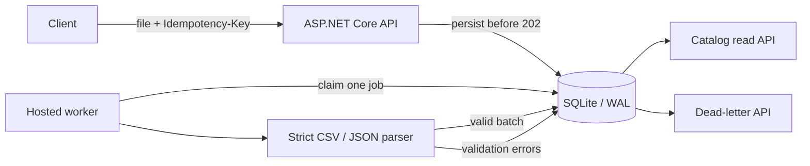

# Catalog Ingestion Lab

[](https://github.com/seljawhari/catalog-ingestion-lab/actions/workflows/ci.yml)

A production-minded .NET 10 reference service for accepting CSV and JSON product catalogs, validating them asynchronously, and applying an all-or-nothing upsert to a queryable catalog.

The project intentionally focuses on the failure modes that make ingestion systems interesting: duplicate submissions, malformed source data, interrupted workers, bounded retries, dead letters, and atomic writes. The domain and all sample data are synthetic.

## What it demonstrates

- Idempotent `multipart/form-data` submission with payload hashing and conflict detection
- Durable SQLite-backed job state: `Queued`, `Processing`, `RetryScheduled`, `Completed`, and `DeadLettered`
- Strict CSV/JSON parsing, row-level validation, normalized SKUs, and integer minor-unit money storage
- Atomic catalog upserts: a file either applies completely or makes no catalog changes
- Exponential retries that preserve accepted order, persisted dead letters, and an explicit requeue endpoint
- Bounded dead-letter payload retention while keeping lightweight failure metadata
- Startup recovery for work interrupted by a process stop
- Structured logs, correlation IDs, custom `ActivitySource` spans, and `Meter` counters/histograms
- Request-size, row-count, rate, and query bounds
- Unit, persistence, processor, and end-to-end HTTP contract tests

## Architecture



The API and worker deliberately run in one process. SQLite is a practical local durability mechanism, not a horizontal queue. If multiple replicas or sustained concurrent writes become requirements, keep the HTTP/domain contracts and move job/catalog persistence to PostgreSQL or a managed queue plus database. See [architecture.md](docs/architecture.md) and the [decision records](docs/adr).

## Run locally

Requirements: [.NET SDK 10](https://dotnet.microsoft.com/download/dotnet/10.0).

```bash
dotnet restore CatalogIngestionLab.slnx
dotnet run --project src/CatalogIngestion.Api
```

The API announces its local URL at startup. OpenAPI is available at `/openapi/v1.json`; liveness and readiness are at `/health/live` and `/health/ready`.

Submit a sample file:

```bash
curl --fail-with-body \
  -H 'Idempotency-Key: catalog-demo-001' \
  -F 'file=@samples/catalog.csv;type=text/csv' \
  http://localhost:5000/v1/ingestions
```

The response is `202 Accepted` with a `statusUrl`. Poll that URL until the status is terminal, then inspect the catalog:

```bash
curl --fail-with-body http://localhost:5000/v1/catalog/items
```

Reusing the key with the identical byte payload returns the original job with `"replayed": true`. Reusing it with different bytes returns `409 Conflict`.

## Run with Docker

```bash
docker compose up --build
```

The service listens on [http://localhost:8080](http://localhost:8080). A named volume stores the database and its WAL files across container restarts. The image runs as a non-root user with a read-only root filesystem. Do not place the SQLite volume on NFS, SMB, or another network filesystem.

## Input contract

CSV must contain exactly these case-insensitive headers:

```text
sku,name,price,currency,stock
```

JSON must be an array of objects with exactly the same five fields. Unknown JSON fields and extra CSV columns are rejected. Defaults limit files to 5 MiB and 10,000 rows.

| Field | Rule |
| --- | --- |
| `sku` | 1-64 letters, numbers, `.`, `_`, or `-`; normalized uppercase; unique per file |
| `name` | 1-200 characters |
| `price` | 0-1,000,000,000 with at most two decimal places |
| `currency` | Three letters; normalized uppercase |
| `stock` | Integer from 0-1,000,000 |

## API surface

| Method | Route | Purpose |
| --- | --- | --- |
| `POST` | `/v1/ingestions` | Persist a CSV/JSON upload; requires `Idempotency-Key` |
| `GET` | `/v1/ingestions/{jobId}` | Read status, attempts, validation details, and `requeueable` |
| `GET` | `/v1/catalog/items` | Page through catalog items with `limit` and `afterSku` |
| `GET` | `/v1/catalog/items/{sku}` | Read one normalized catalog item |
| `GET` | `/v1/dead-letters` | Inspect failed jobs |
| `POST` | `/v1/dead-letters/{jobId}/requeue` | Requeue a retained dead letter |

## Correctness model

- A submission is acknowledged only after its immutable payload and job record are durable.
- A unique idempotency key plus SHA-256 payload hash makes client retries deterministic.
- Each accepted submission receives a durable monotonic sequence; the worker only claims the oldest active sequence.
- A scheduled automatic retry holds its place, so a newer accepted batch cannot be applied first and later overwritten by stale work.
- Successful item upserts and the `Completed` transition share one transaction.
- Validation failures never write partial catalog rows and are not retried.
- Unexpected processing failures use bounded exponential retries, then become dead letters.
- Completed payloads are cleared. By default only the 20 newest dead-letter payloads are retained for requeue; older failure metadata remains queryable with `requeueable: false`.
- Startup recovery reschedules any job left in `Processing` by an interrupted worker.
- Manual requeue is an explicit new operator decision, so the job receives a fresh sequence and rejoins the tail of the active queue.

Strict ordering can briefly hold newer work behind an older scheduled retry; retry delays and attempts are bounded. This sample has one worker and one process by design. It does not claim distributed exactly-once processing. The idempotency, ordering, and atomic-commit boundaries provide the useful application-level guarantee: repeated client submissions do not create duplicate jobs, accepted batches cannot be applied out of order, and a catalog batch is applied at most once by the local worker.

## Observability

Every response includes `X-Correlation-ID`; a valid incoming value is propagated, otherwise the service creates one. Processing logs carry `JobId` and `Attempt` scopes. `CatalogIngestionLab` exposes manual diagnostics through:

- `ActivitySource`: ingestion processing spans
- `Meter`: submissions, replays, completions, failures, processed rows, and processing duration

The hooks are vendor-neutral. A host can attach OpenTelemetry exporters without changing ingestion code.

## Verify

```bash
dotnet format CatalogIngestionLab.slnx --verify-no-changes
dotnet build CatalogIngestionLab.slnx --configuration Release
dotnet test CatalogIngestionLab.slnx --configuration Release --collect:'XPlat Code Coverage'
dotnet list CatalogIngestionLab.slnx package --vulnerable --include-transitive
docker build -t catalog-ingestion-lab .
```

The GitHub Actions workflow runs formatting, restore, build, tests with coverage collection, dependency audit, and an image build.

## Configuration

Configuration uses standard ASP.NET Core providers. Common environment overrides include:

```text
ConnectionStrings__Catalog
Ingestion__MaxPayloadBytes
Ingestion__MaxItems
Ingestion__MaxAttempts
Ingestion__PollIntervalMilliseconds
Ingestion__RetryBaseDelaySeconds
Ingestion__MaxRetainedDeadLetterPayloads
Ingestion__WorkerEnabled
```

`MaxRetainedDeadLetterPayloads` defaults to 20 and may be set from 0 through 100. Pruning clears only the uploaded payload BLOB; status, timestamps, filename, attempts, and validation details remain available. The maximum retained dead-letter bytes are therefore bounded by this value multiplied by `MaxPayloadBytes` (100 MiB with both defaults).

## Scope and provenance

This is an independent portfolio/reference implementation. It contains no employer source code, private schemas, production data, internal documentation, or company-specific behavior. See [PROVENANCE.md](PROVENANCE.md), [SECURITY.md](SECURITY.md), and [LICENSE](LICENSE).
