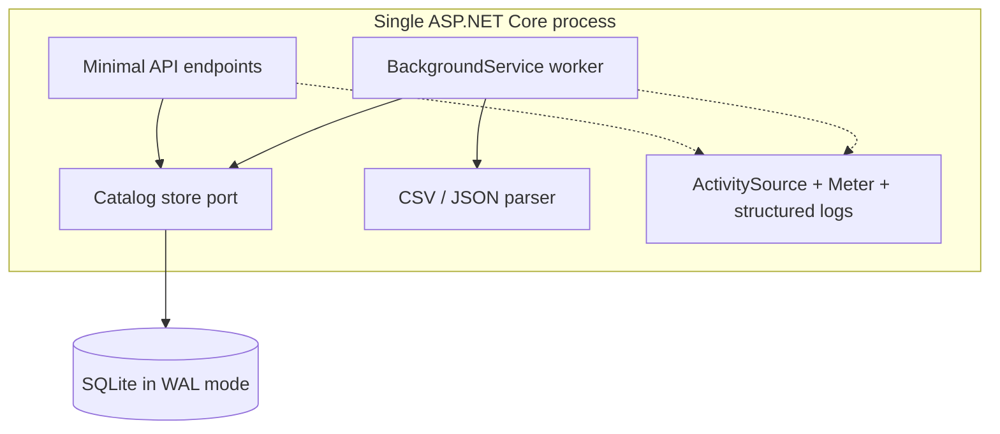
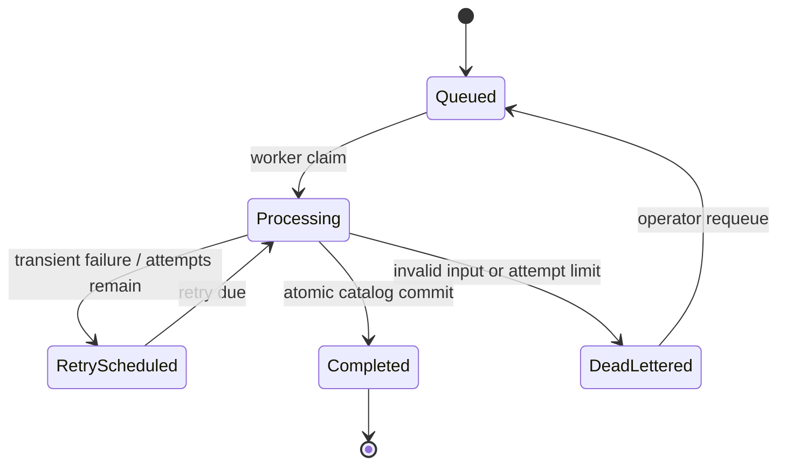

# Architecture

## Context

Catalog clients need to upload bounded CSV or JSON files without holding an HTTP request open while every row is parsed and committed. Retries must not create duplicate jobs, and malformed files must not partially modify the catalog.

## Components



The code is grouped by responsibility inside one deployable project:

- `Contracts`: stable HTTP response shapes
- `Domain`: job states, validated item types, and validation issues
- `Ingestion`: request validation, parsing, processing, and worker orchestration
- `Persistence`: the storage port and SQLite implementation
- `Observability`: correlation and vendor-neutral diagnostic hooks

This keeps the sample easy to run while preserving seams for a different database, parser, clock, or telemetry sink.

## Submission flow

```mermaid
sequenceDiagram
    participant C as Client
    participant A as API
    participant D as SQLite
    participant W as Worker
    C->>A: POST file + Idempotency-Key
    A->>A: Bound request, detect format, hash bytes
    A->>D: Insert payload and Queued job
    D-->>A: Created, replayed, or conflict
    A-->>C: 202 + status URL / 409
    W->>D: Claim eligible job
    W->>W: Parse and validate outside transaction
    alt valid
        W->>D: Upsert all items + mark Completed atomically
    else invalid
        W->>D: Persist validation details; no catalog writes
    else unexpected failure
        W->>D: Schedule retry or mark DeadLettered
    end
```

## State machine



Validation failures share the terminal `DeadLettered` representation in this compact sample so operators have one inspection surface. They are explicitly non-retryable and make zero catalog changes. A larger system could split them into a separate `Rejected` state without changing the submission contract.

## Persistence and failure boundaries

- The payload is stored as a BLOB in the same row as the job, avoiding a database/filesystem atomicity gap.
- SQLite uses WAL mode, full synchronous writes, foreign keys, and a finite busy timeout.
- The dispatcher selects and updates one eligible job inside a serializable transaction; parsing happens after that transaction closes.
- Catalog changes and successful acknowledgement share one transaction.
- The worker processes one job at a time, so an older job cannot race a newer job inside this deployment model.
- On startup, `Processing` rows are moved to retry or dead-letter state based on their persisted attempt count.
- Completed payloads are removed to bound storage. Dead-letter payloads remain available for explicit requeue.

SQLite's asynchronous APIs execute synchronously underneath. Transactions are intentionally short and batches are capped. This design supports a single local process on a local disk. WAL still has one writer and depends on same-machine file locking; network filesystems and multiple replicas are unsupported.

## Scale-out path

When the single-process constraint stops fitting:

1. Implement `ICatalogStore` with PostgreSQL and use row locking (`FOR UPDATE SKIP LOCKED`) or publish durable job IDs to a managed queue.
2. Add renewable leases and fencing tokens before allowing concurrent workers.
3. Persist submission sequence on catalog rows so older work cannot overwrite newer accepted state.
4. Stage large batches and merge them set-wise instead of issuing one upsert per row.
5. Export the existing `ActivitySource` and `Meter` through an OpenTelemetry collector.

Those are deliberate next-stage investments, not hidden guarantees of this local reference implementation.

## Security posture

The service assumes deployment behind an authenticated gateway. It applies input, body, row, query, and rate bounds; strips file paths; does not execute uploaded content; avoids reflecting parser exceptions; and runs non-root in the supplied container. See [SECURITY.md](../SECURITY.md) for trust boundaries and reporting.
